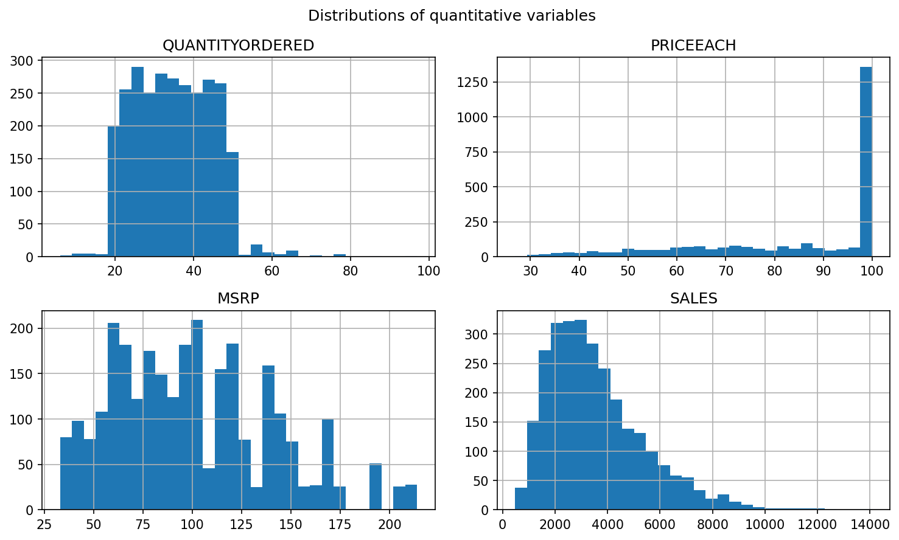
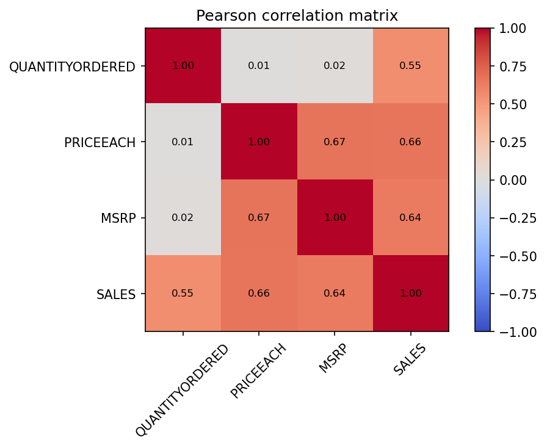
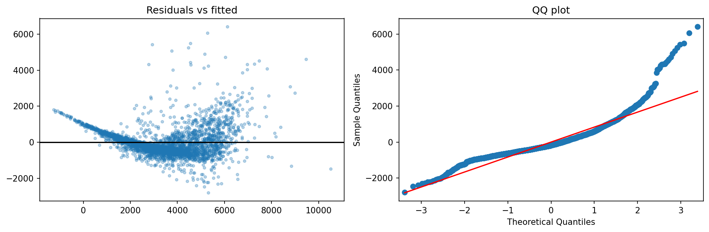
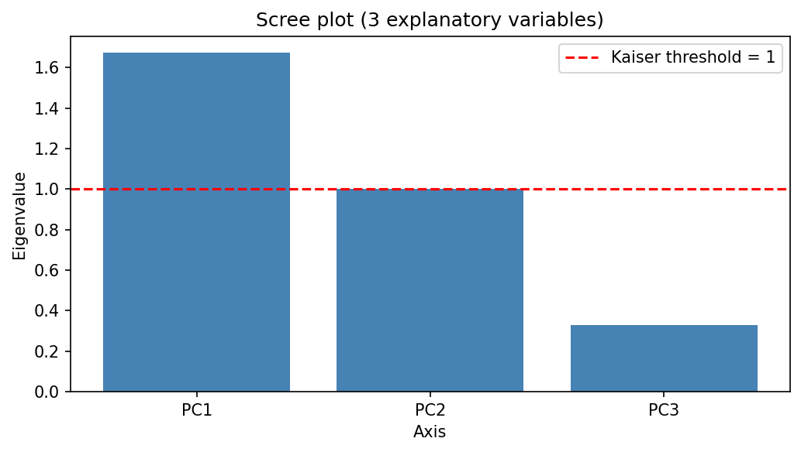
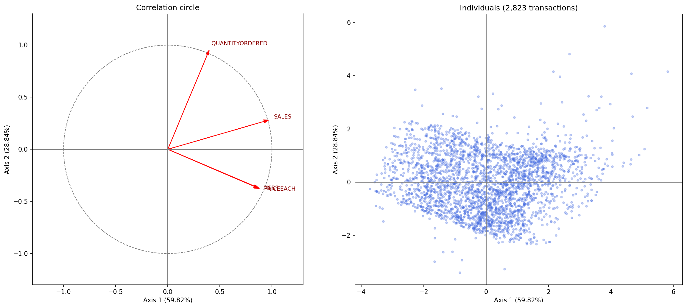
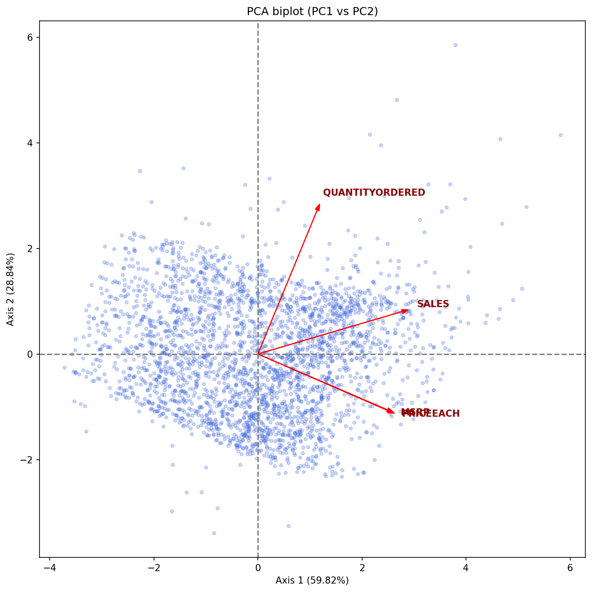
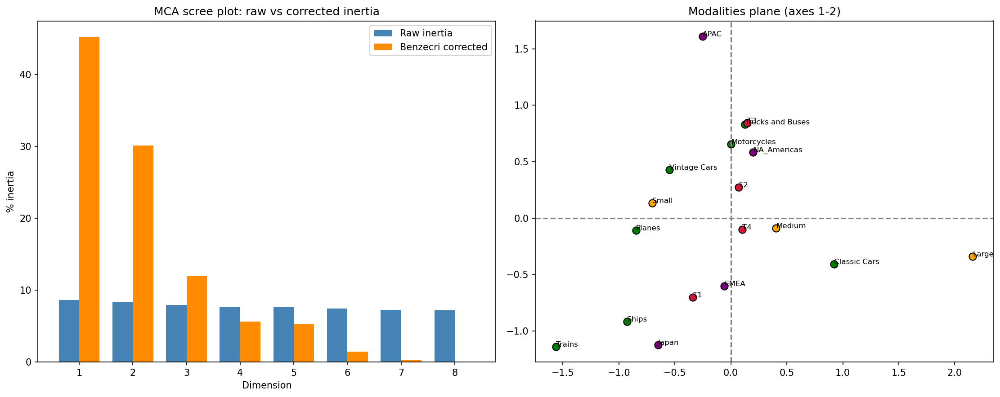
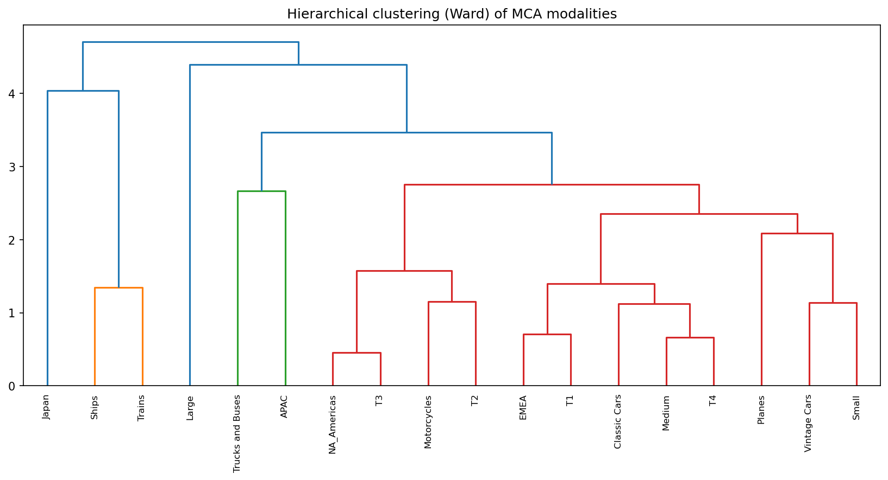
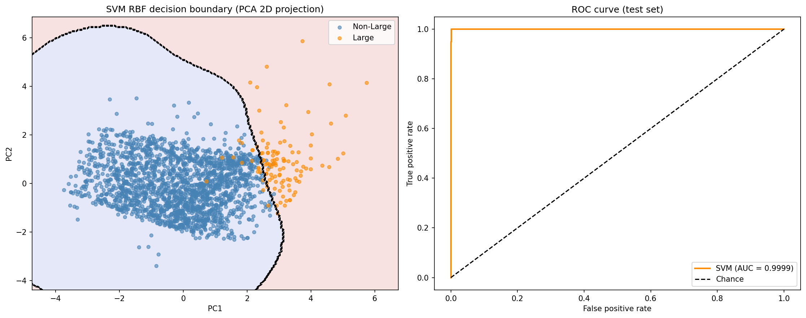

# Sales Data Analysis: OLS Regression, PCA, MCA and SVM

**Repository:** [github.com/becem69/data-analysis-project](https://github.com/becem69/data-analysis-project)


A statistical study of transaction-level sales revenue using **Ordinary Least Squares (OLS / MCO)** and **Principal Component Analysis (PCA / ACP)**, with a principal component regression (PCR), a log-log robust model, a **Multiple Correspondence Analysis (MCA / ACM)** with Benzécri correction and hierarchical clustering, and a **Support Vector Machine (SVM)** classifier. The work follows a case-study format: an executive asks *why* sales move and *how* to steer them, and the analyst team must answer with statistical evidence.

All four methods are implemented in a single script (see [Roadmap](#roadmap)). The console output is in English and the figures are saved to `images/`.

## Table of contents

- [Overview](#overview)
- [Dataset](#dataset)
- [Repository structure](#repository-structure)
- [Methodology](#methodology)
- [Key results](#key-results)
- [Figures](#figures)
- [Getting started](#getting-started)
- [Reading the output](#reading-the-output)
- [Limitations](#limitations)
- [Roadmap](#roadmap)
- [Sources](#sources)
- [Author](#author)

## Overview

The analysis answers four questions:

1. **What is the effect of price and volume on revenue?** Estimated with OLS on `QUANTITYORDERED`, `PRICEEACH` and `MSRP`.
2. **Are the estimates reliable?** Tested with Fisher and Student tests, VIF, Jarque-Bera, Breusch-Pagan and Durbin-Watson, and re-estimated with HC3 robust errors and a log-log specification.
3. **What is the structure of the quantitative space?** Explored with PCA (eigenvalues, Kaiser rule, loadings, correlation circle, individuals plane, biplot) and used in a PCR.
4. **Which customer-product profiles exist, and can large orders be scored automatically?** MCA on four qualitative variables, followed by a Ward hierarchical clustering and an RBF SVM classifier.

## Dataset

- **Name:** Sample Sales Data (Kaggle, author `kyanyoga`)
- **Link:** https://www.kaggle.com/datasets/kyanyoga/sample-sales-data
- **File:** `sales_data_sample.csv`, 2,823 rows and 25 columns, read with `encoding='latin1'`

Variables used:

| Role | Variables |
|---|---|
| Quantitative (OLS, PCA, SVM) | `QUANTITYORDERED`, `PRICEEACH`, `MSRP`, `SALES` |
| Qualitative (MCA, SVM, CAH) | `PRODUCTLINE`, `DEALSIZE`, `COUNTRY`, `STATUS`, `TERRITORY`, `QTR_ID` |

No missing values were found in the first eight columns, so all 2,823 observations are kept. The 1,074 missing `TERRITORY` values are imputed as `NA_Americas` for the MCA, and `TRIMESTRE` is derived from `QTR_ID`.

## Repository structure

```
.
├── project.py                       # Full analysis pipeline (English output, run top to bottom)
├── output.txt                       # Console output saved by project.py
├── Why_This_Method.pptx             # 18-slide presentation: why each method was chosen
├── presentation_script.md           # Speaker notes, slide by slide (also embedded in the PPTX)
├── requirements.txt                 # Python dependencies
├── README.md
├── .gitignore
├── images/                          # Figures saved by project.py (see Figures)
│   ├── fig_01_histograms.png
│   ├── fig_02_correlation_heatmap.png
│   ├── fig_03_ols_residual_diagnostics.png
│   ├── fig_04_scree_plot.png
│   ├── fig_05_correlation_circle_individuals.png
│   ├── fig_06_biplot.png
│   ├── fig_07_mca_benzecri.png
│   ├── fig_08_cah_dendrogram.png
│   └── fig_09_svm_decision_boundary_roc.png
├── reponses_questions.md            # Answers to the 16 questions of the French workbook
└── sales_data_sample.csv            # Provided locally / download from Kaggle
```

> `reponses_questions.md` is written in French because the questions in the source PDF are French.

## Methodology

`project.py` runs twelve sections in order:

| # | Step | What it does |
|---|---|---|
| 1 | Structural audit | Types, missing values, clean subset, check of `SALES` against `QUANTITYORDERED x PRICEEACH` |
| 2 | Univariate audit | Mean, std, median, min, max, skewness, category frequencies, rare modalities (< 2%) |
| 3 | Bivariate analysis | Pearson matrix and heatmap, chi-square test and Cramér's V (`PRODUCTLINE` vs `DEALSIZE`) |
| 4 | Outliers | Mahalanobis distance on the explanatory variables (chi-square threshold, p < 0.001) |
| 5 | OLS | Fit, VIF, Jarque-Bera, Breusch-Pagan, Durbin-Watson, residual and QQ plots |
| 6 | Robust and log-log OLS | HC3 standard errors and elasticities from `log(SALES)` on logged regressors |
| 7 | PCA (3 explanatory variables) | Eigenvalues, inertia, Kaiser rule, scree plot, loadings |
| 8 | PCR | OLS of `SALES` on the retained components, VIF check |
| 9 | PCA (4 variables) | Correlation circle, individuals plane, biplot |
| 10 | Model comparison | R², AIC and maximum VIF for OLS, PCR and log-log |
| 11 | MCA + CAH | Disjunctive table, chi² metric, Benzécri correction, modality contributions, Ward dendrogram |
| 12 | SVM | Stratified 75/25 split, train-only standardisation, RBF classifier, confusion matrix, F1, ROC curve |

Standardisation (zero mean, unit variance) is applied before every PCA and before the SVM. The PCA used for PCR is fitted on the three explanatory variables only, so the dependent variable never enters the regressors.

## Key results

**Exploratory findings**

- `QUANTITYORDERED` is uncorrelated with price (r = 0.006) and with `MSRP` (r = 0.018).
- `PRICEEACH` and `MSRP` are moderately correlated (r = 0.671, VIF ≈ 1.82).
- `SALES` is strongly but not exactly `QUANTITYORDERED x PRICEEACH` (correlation 0.864 in this file).
- 13 multivariate outliers (0.46%) were detected and kept.
- `PRODUCTLINE` and `DEALSIZE` are significantly associated (chi-square = 135.36, 12 d.f., p = 5.16e-23), but the association is weak (Cramér's V = 0.155).

**Model comparison**

| Model | R² | AIC | Max VIF | Remark |
|---|---|---|---|---|
| OLS (raw) | 0.796 | 45,981.5 | 1.82 | Non-normal, heteroscedastic residuals |
| PCR (2 components) | 0.794 | 46,001.6 | 1.00 | No gain, discards discount information |
| Log-log (HC3) | 0.906 | -2,322.6* | 1.82 | Best fit, interpretable elasticities |

\* Not comparable with the other AICs because the dependent variable is `log(SALES)`.

**OLS coefficients (raw model)**

| Term | Coefficient | Std. error | t | VIF |
|---|---|---|---|---|
| Intercept | -4878.88 | 87.54 | -55.74 | |
| `QUANTITYORDERED` | 102.67 | 1.61 | 63.81 | 1.00 |
| `PRICEEACH` | 39.04 | 1.05 | 37.28 | 1.82 |
| `MSRP` | 15.52 | 0.53 | 29.53 | 1.82 |

**PCA**

- Three explanatory variables: eigenvalues 1.6716, 1.0001 and 0.3294, which retain 89.02% of the inertia with two axes.
- PC1 is a *unit value* axis (`PRICEEACH` and `MSRP`), PC2 is a *volume* axis (`QUANTITYORDERED`), and PC3 contrasts price with `MSRP`, which can be read as discount depth.
- Four variables, first plane: 59.82% + 28.84% = 88.66% of the inertia.

**MCA / ACM**

- Raw inertia is flat (8.65%, 8.37%, ...); after Benzécri correction the first plane carries 45.22% + 30.14% = 75.36%.
- Axis 1 is driven by `Classic Cars` (24.02% contribution), `Large` deals (21.40%) and `Small` deals (18.41%).
- Axis 2 is spatio-temporal: `APAC`, `EMEA`, `NA_Americas` and quarter T3.
- Ward clustering groups the 18 modalities into 4 actionable segments.

**SVM**

- RBF kernel, `C = 10`, `gamma = 'scale'`, features standardised on the training set only.
- Accuracy 99.58%, AUC-ROC 0.9999, F1 = 0.961 on the rare `Large` class.
- Confusion matrix on the 706 test orders: 666 true negatives, 1 false positive, 2 false negatives, 37 true positives.

**Main conclusions**

1. Price and volume are independent and both drive revenue strongly, so they can be managed as separate levers.
2. Multicollinearity is moderate (maximum VIF 1.82, below the usual thresholds of 5 or 10), so PCR is not needed and slightly degrades the model. A VIF of 1.0 in a PCR is guaranteed by orthogonality and does not prove a better model.
3. The preferred specification is the log-log model with HC3 errors. Elasticities are about 1.00 for quantity, 1.06 for price and 0.28 for `MSRP`.
4. Because price and quantity do not co-move, these elasticities reflect how revenue is composed. They are **not** a demand elasticity.
5. Residual non-normality persists in every model, so prediction intervals should be treated with caution.
6. MCA gives a readable commercial segmentation, and the SVM can score new orders — but `DEALSIZE` is a binning of `SALES`, so part of the 99% score comes from relearning a business rule. Use pre-order variables for a truly predictive score.

## Figures

`project.py` saves every plot to the `images/` folder as it displays it. The figures below are listed in the order the script shows them.

### 1. Distributions of the quantitative variables (section 2)



Shows the right skew of `SALES` and the left skew of `PRICEEACH` seen in the univariate audit.

### 2. Pearson correlation heatmap (section 3)



`QUANTITYORDERED` is independent of price, while `PRICEEACH` and `MSRP` are moderately correlated (r = 0.671).

### 3. OLS residual diagnostics (section 5)



Residuals vs fitted values reveal heteroscedasticity, and the QQ plot shows heavy tails (kurtosis 11.48).

### 4. Scree plot (section 7)



Eigenvalues of the three explanatory variables with the Kaiser threshold at 1; two axes are retained.

### 5. Correlation circle and individuals plane (section 9)



Left: variables on the first factorial plane (value axis and volume axis). Right: the 2,823 transactions as points.

### 6. PCA biplot (section 9)



Variables and individuals superimposed on the plane that explains 88.66% of the inertia.

### 7. MCA scree plot and modality map (section 11)



Left: raw inertia is compressed; Benzécri correction reveals the first two axes. Right: the 18 active modalities in the factorial plane.

### 8. Hierarchical clustering of modalities (section 11)



The dendrogram groups the modalities into four commercial segments.

### 9. SVM decision boundary and ROC curve (section 12)



Left: non-linear RBF boundary in the 2D PCA projection. Right: ROC curve on the test set (AUC = 0.9999).

> The images are generated when you run the script. They are already included in `images/` so they appear directly on GitHub.

## Getting started

### 1. Clone the repository

```bash
git clone https://github.com/becem69/data-analysis-project.git
cd data-analysis-project
```

### 2. Create an environment and install dependencies

```bash
python3 -m venv venv
source venv/bin/activate          # Windows: venv\Scripts\activate
pip install -r requirements.txt
```

`requirements.txt`:

```
pandas
numpy
matplotlib
scipy
statsmodels
scikit-learn
kagglehub
```

### 3. Download the dataset

The file `sales_data_sample.csv` is already present in this working folder. If you clone the repository elsewhere, download it from https://www.kaggle.com/datasets/kyanyoga/sample-sales-data, unzip it, and place `sales_data_sample.csv` next to `project.py`.

Option with `kagglehub`:

```python
import kagglehub
path = kagglehub.dataset_download("kyanyoga/sample-sales-data")
print(path)
```

Check that it loads correctly:

```bash
python3 -c "import pandas as pd; print(pd.read_csv('sales_data_sample.csv', encoding='latin1').shape)"
# (2823, 25)
```

### 4. Run the analysis

```bash
python project.py | tee output.txt
```

Each plot window pauses the script until it is closed, and each figure is saved to `images/`. The console output is also written to `output.txt` by the script itself. On a headless machine, run `MPLBACKEND=Agg python project.py` to save the figures without opening windows.

## Reading the output

| Output | What to check |
|---|---|
| OLS summary | R², F-statistic, signs and sizes of coefficients, t-tests |
| VIF table | Values above 5 or 10 signal harmful multicollinearity |
| Jarque-Bera | A small p-value rejects normal residuals |
| Breusch-Pagan | A small p-value rejects constant error variance, so use HC3 errors |
| Durbin-Watson | Meaningful only if rows are ordered in time (not the case here) |
| Eigenvalue table | Keep axes with eigenvalue above 1 and enough cumulative inertia (about 70 to 80%) |
| Loadings | Name each axis from the variables that load heavily on it |
| MCA inertia table | Compare raw inertia with Benzécri-corrected inertia before choosing axes |
| SVM report | Accuracy alone is misleading with a 5.56% minority class; read AUC and F1 |

## Limitations

- The data are cross-sectional and the rows have no usable time order, so autocorrelation tests have no clear meaning.
- `SALES` is largely a function of the regressors, which inflates R² and makes the elasticities partly arithmetic.
- Results describe association, not causation.
- Chi-square tests on `PRODUCTLINE` vs `DEALSIZE` involve empty or very small cells (for example, no Large deals for Ships).
- Six countries and four order statuses fall below 2% frequency and should be grouped before MCA; the MCA here uses `TERRITORY` and `TRIMESTRE` instead.
- `DEALSIZE` is a deterministic binning of `SALES`, so the SVM partly relearns a business rule. A truly predictive score needs pre-order features.
- A linear SVM reaches 100% accuracy on this dataset, so the RBF kernel's superiority is not demonstrated here.

## Roadmap

- [x] Data preparation and exploratory analysis
- [x] OLS with diagnostics, robust errors and log-log model
- [x] PCA, PCR and graphical representations
- [x] Multiple Correspondence Analysis with Benzécri correction and CAH
- [x] Support Vector Machine classification with standardised features and ROC analysis
- [x] Answers to the 16 critical questions of the French workbook
- [ ] Deployment of the SVM scoring rule in a CRM with pre-order features and drift monitoring

## Sources

- **Dataset:** Kyanyoga, *Sample Sales Data*, Kaggle. https://www.kaggle.com/datasets/kyanyoga/sample-sales-data
- **Library:** scikit-learn developers, *scikit-learn: Machine Learning in Python*. https://github.com/scikit-learn/scikit-learn
- **Methods:** Gujarati & Porter (2009), Greenacre (1984), Husson, Lê & Pagès (2017), Hastie, Tibshirani & Friedman (2009).

## Author

**Bacem El Manai** — GitHub: [becem69](https://github.com/becem69) — ISET'COM, Management of Information and Communication Technologies — contact: becem69
